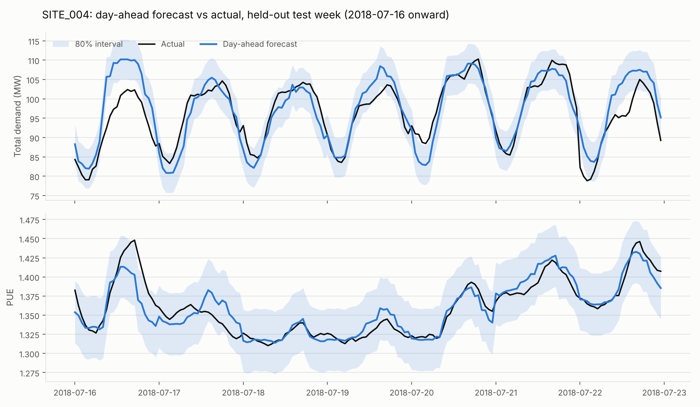
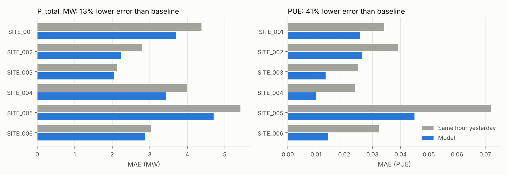
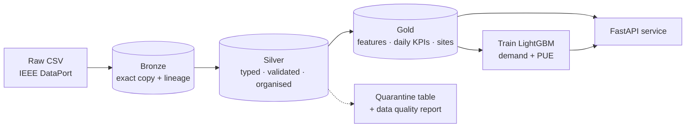

# Weather-Aware Data Centre Load Forecasting

[](https://github.com/MurimiCaroline/dc-load-forecasting/actions/workflows/tests.yml)


**Predicting the next 24 hours of power demand and PUE for six data centre sites, with a bronze → silver → gold data pipeline and an API you can test from your browser.**



---

## Contents

1. [The problem in plain words](#1-the-problem-in-plain-words)
2. [What this project delivers](#2-what-this-project-delivers)
3. [Results](#3-results)
4. [How it works, end to end](#4-how-it-works-end-to-end)
5. [Step 0: understanding the data first](#5-step-0-understanding-the-data-first)
6. [The medallion pipeline](#6-the-medallion-pipeline)
7. [How the model avoids cheating (data leakage)](#7-how-the-model-avoids-cheating-data-leakage)
8. [Training and evaluation](#8-training-and-evaluation)
9. [The API](#9-the-api)
10. [Run it yourself](#10-run-it-yourself)
11. [Project structure](#11-project-structure)
12. [Tests](#12-tests)
13. [Design decisions and what was tried](#13-design-decisions-and-what-was-tried)
14. [Limitations and next steps](#14-limitations-and-next-steps)
15. [Glossary](#15-glossary)
16. [Data source](#16-data-source)
17. [License](#license)

---

## 1. The problem in plain words

A data centre is a building full of servers. Its electricity goes to three places:

```
total power  =  IT power (servers)  +  cooling power  +  other power (lighting, UPS losses, ...)
```

Operators care about two numbers:

- **Total power demand (MW).** They agree capacity with the utility and plan energy purchases a day in advance, so they need to know tomorrow's demand today.
- **PUE (Power Usage Effectiveness)** = total power ÷ IT power. A PUE of 1.0 would mean every watt goes to the servers. A PUE of 1.4 means 0.4 W of overhead, mostly cooling, for every 1 W of IT. Lower is better. PUE rises on hot days because cooling works harder.

**The question this project answers:** at midnight, how much power will each site draw in every hour of tomorrow, and how efficient will it be? It also answers what-if questions, such as "what if tomorrow is 5 °C hotter?".

---

## 2. What this project delivers

| Piece | What it is | Where |
|---|---|---|
| **Data pipeline** | Raw CSV → bronze (raw copy) → silver (cleaned and validated) → gold (model-ready features and KPIs) | `src/dcforecast/bronze.py`, `silver.py`, `gold.py` |
| **Forecasting models** | Two LightGBM models: one for total demand, one for PUE, with 80% prediction intervals | `src/dcforecast/train.py`, `models/` |
| **REST API** | FastAPI service: forecasts, what-if scenarios, site KPIs and a model card, with interactive docs | `src/dcforecast/api/` |
| **Data quality report** | Every validation rule and how many rows failed it | `data/silver/dq_report.json` |
| **Evaluation report** | Test metrics, baselines, per-site errors and feature importance | `reports/metrics.json`, `reports/figures/` |
| **Tests** | 19 automated tests, including a leakage test | `tests/` |

---

## 3. Results

The models were scored once on **16–31 July 2018**, a window they never saw during training or tuning (2,304 site-hours).

To judge whether a model is any good, you compare it with a simple rule a person could use without ML. Here that rule is "**tomorrow at 3 p.m. will look like today at 3 p.m.**", called the *same hour yesterday* baseline.

| Target | Model error (MAE) | Average % error (MAPE) | Same hour yesterday | Same hour last week | Error reduction vs yesterday |
|---|---|---|---|---|---|
| **Total demand** | **3.17 MW** | **5.1%** | 3.62 MW | 4.16 MW | **13%** |
| **PUE** | **0.022** | **1.6%** | 0.038 | 0.034 | **41%** |

**What the results show:**

- **The model beats the baseline at every site, for both targets.** See the chart below.
- **The uncertainty bands are honest.** The model gives a band that should contain the true value 80% of the time. On unseen data it did so 79.5% of the time for demand and 84.3% for PUE.
- **Weather mainly affects efficiency, not demand.** Temperature is a top-5 input for PUE. Demand is driven mostly by recent load and which site it is. A +5 °C what-if raises SITE_004's forecast daily PUE from 1.349 to 1.365.
- **Each model input had to earn its place.** The workload "regime" label was tested and made demand forecasts slightly worse, so it was left out.



---

## 4. How it works, end to end



One command runs the whole pipeline in about 5 seconds:

```bash
python -m dcforecast.pipeline
```

| Stage | Input | Output | One-line purpose |
|---|---|---|---|
| bronze | raw CSV | `data/bronze/` | Keep an untouched, traceable copy of the source |
| silver | bronze | `data/silver/` | Fix types, check every row, organise into clean tables |
| gold | silver | `data/gold/` | Build model features and business KPIs |
| train | gold | `models/`, `reports/` | Train, evaluate against baselines, save models |

The API then loads `data/gold/` and `models/` and serves predictions.

---

## 5. Step 0: understanding the data first

Before writing any pipeline code, the data was profiled. The checks below each produced a design decision.

| Check | Code idea | Finding | Decision |
|---|---|---|---|
| Is every hour present for every site? | Compare `len(site_rows)` with `pd.date_range(start, end, freq="h")` | 2,208 of 2,208 hours, no duplicates | `shift(24)` reliably means "24 hours ago", so lag features are safe |
| Do the energy sums hold? | `(P_total − (P_IT + P_cool + P_other)).abs().max()` | Error around 1e-14, which is floating-point rounding | These become validation rules, checked with a tolerance |
| Is weather different per site? | `pivot` temperature by site, then `nunique(axis=1)` | Identical: all sites use Syracuse weather | Store weather once in its own table |
| Does `regime` change within a day? | `groupby([site, date]).regime.nunique().max()` | Never: it's a daily label | Treat it as a candidate feature and test it |
| Which columns are measured in the same hour as the target? | Reasoning from the identities | `P_IT_MW`, `P_cool_MW`, `P_other_MW`, `u_it_frac` | **Banned as features** (see section 7) |
| How much does load repeat itself? | `series.autocorr(24)`, `autocorr(168)` | About 0.78 for daily and weekly cycles | Lag-24 and lag-168 are key features and the baselines to beat |

**The forecast rule all later code follows:**

> At midnight before day D, predict all 24 hours of D using only data up to D−1 23:00, plus the calendar, the site's attributes and the weather forecast.

---

## 6. The medallion pipeline

"Medallion" is a common way to organise data in layers, where each layer is more trustworthy than the one before. The data is stored as **Parquet**, a column-based file format that keeps data types (dates stay dates), compresses well (the 3.6 MB CSV becomes 1.0 MB in silver), and is the format used under Delta Lake and Apache Iceberg tables.

### Bronze: the untouched copy (`bronze.py`)

- Reads the CSV with every value **as text** (`dtype=str`), so nothing is reinterpreted.
- Adds lineage columns:
  - `_source_file`
  - `_source_sha256`: a fingerprint of the file
  - `_source_row`: the original line number
  - `_ingested_at`
- Writes a `_manifest.json` describing the load.

**Why:** if a strange number appears later, you can trace it back to the exact row of the exact file it came from.

### Silver: trusted data (`silver.py`)

1. **Schema check.** Stops immediately if an expected column is missing.
2. **Type casting.** Text becomes dates, integers and floats. Unparseable values become `NaN` (`errors="coerce"`) so they can be reported rather than crashing the run.
3. **Row validation.** Each row is tested against these rules:

   | Rule | Catches |
   |---|---|
   | `unparseable_value` | Text that isn't a valid number or date |
   | `missing_category` | Blank site ID, regime, etc. |
   | `duplicate_site_timestamp` | The same site and hour appearing twice |
   | `out_of_range` | Physically impossible values (humidity > 100%, PUE < 1, negative MW) |
   | `total_ne_components` | Total ≠ IT + cooling + other |
   | `pue_ne_total_over_it` | PUE ≠ total ÷ IT |
   | `cooling_share_inconsistent` | Cooling share ≠ cooling ÷ overhead |
   | `calendar_mismatch` | `hour` or `day_of_week` columns disagree with the timestamp |

   Failing rows go to a **quarantine table** labelled with the rules they broke. They are never silently dropped.
4. **Completeness check.** Confirms every site has every hour.
5. **Organising.** The single wide table is split into:
   - `sites`: one row per site
   - `weather_hourly`: one row per location and hour
   - `load_profiles`: the hourly measurements, plus UTC timestamps
6. **Report.** Writes `dq_report.json`.

**Result for this dataset:** 13,248 of 13,248 rows passed, 0 were quarantined and no hours were missing.

### Gold: ready to use (`gold.py`)

| Table | Contents | Used by |
|---|---|---|
| `features_hourly` | One row per site and hour, with targets and every model feature | Training, API |
| `site_daily_kpis` | Daily energy (MWh), peak MW, daily PUE, load factor, cooling share of energy, heatwave hours | `/sites/{id}/kpis` |
| `dim_sites` | Site attributes and summary statistics | `/sites` |

**Note on daily PUE:** it's calculated as total energy ÷ IT energy for the day, not as the average of 24 hourly PUE values. An average would give a quiet 3 a.m. hour the same weight as a busy afternoon, which misstates efficiency.

---

## 7. How the model avoids cheating (data leakage)

**Data leakage** happens when a model is trained with information it wouldn't have when making a real prediction. It produces impressive scores that collapse in real use.

In this dataset, total power is exactly IT + cooling + other power. A model given those three for the same hour could add them up and score almost perfectly, but tomorrow's IT load isn't known tonight. So the rule for every feature is:

> **Would I know this value at midnight before the day I'm forecasting?**

| Feature group | Examples | Known at midnight? |
|---|---|---|
| Load history | Same hour 1, 2 and 7 days ago; yesterday's mean, max and last value | ✅ |
| Calendar | Hour, day of week, weekend flag, cyclical encodings | ✅ |
| Weather | Temperature, dew point, humidity, heatwave, cooling degree hours | ✅ (from a weather forecast) |
| Site | Site ID, site class | ✅ |
| Same-hour measurements | `P_IT_MW`, `P_cool_MW`, `P_other_MW`, `u_it_frac` | ❌ never used |

**How the code enforces this** (`features.py`):

```python
# Lags are at least 24 hours, so for any hour of day D they come from day D-1 or earlier
out[f"{target}_lag24"] = df.groupby("site_id")[target].shift(24)

# Yesterday's summary: compute daily stats, move them forward one day, then join
daily["date"] = daily["date"] + pd.Timedelta(days=1)
```

A test (`tests/test_features.py`) adds 1,000 MW to every hour of one day and checks that **none** of that day's features change. If someone later adds a leaky feature, the test fails.

**Two more feature details:**
- **Cyclical time.** As a plain number, hour 23 and hour 0 look far apart, though they're one hour apart. `sin` and `cos` of the hour place hours on a circle so the model sees that midnight follows 23:00.
- **Cooling degree hours** = max(temperature − 18 °C, 0). Cooling demand rises once it's warm enough, so this matches the physics better than raw temperature.

---

## 8. Training and evaluation

### The split: by time, never random

```
 8 May ─────────── 30 Jun │ 1 Jul ── 15 Jul │ 16 Jul ── 31 Jul
          TRAIN           │   VALIDATION    │     TEST
```

A random split would let the model learn from 20 July and be tested on 19 July. That's seeing the future, and it inflates scores. The first week of May isn't used for training, because the 7-day lag needs a week of history.

### The steps (`train.py`)

1. **Fit on train.** LightGBM adds decision trees and stops once validation error hasn't improved for 100 rounds (**early stopping**). This picks the model size without touching the test set.
2. **Build the uncertainty band.** Take the model's errors on the validation set and find the size that 80% of them fall within. That becomes the ± band (the **split conformal** method). It's simple and assumes nothing about the shape of the errors.
3. **Refit on train + validation** with the chosen number of trees, so the final model has the most recent data.
4. **Score once on test**, against two baselines: same hour yesterday and same hour last week.
5. **Ablation.** Retrain with the `regime` feature added to see whether it helps. It didn't, so it stays out.

### Why LightGBM

- It's a gradient-boosted tree model, strong on tabular data with mixed numeric and categorical columns.
- It trains in seconds and needs no feature scaling.
- **One model covers all six sites**, with site ID as a feature, so sites share what they have in common. That helps with only three months of data.

### Which features matter most

- **Demand:** the value 24 hours ago (46% of total gain), 48 hours ago (22%), site ID (16%), then 168 hours ago (11%).
- **PUE:** yesterday's last value (58%), site ID (9%), yesterday's max (8%), yesterday's mean (6%), temperature (4%).

Full details are in `reports/metrics.json` and the `/model` endpoint.

---

## 9. The API

Start it, then open the interactive docs:

```bash
uvicorn dcforecast.api.main:app --reload
# open http://127.0.0.1:8000/docs
```

On the `/docs` page you can click any endpoint, then **Try it out**, then **Execute**, without writing any code.

| Method | Endpoint | What it does |
|---|---|---|
| GET | `/health` | Is the service up and the model loaded? |
| GET | `/model` | Model card: how it was trained, data split, assumptions, test scores, top features |
| GET | `/sites` | The six sites and their summary statistics |
| GET | `/sites/{site_id}/kpis?start=&end=` | Daily KPIs for a site over a date range |
| GET | `/forecast/{site_id}?date=` | 24-hour forecast for any day from 2018-05-08 to 2018-07-31, **shown next to what actually happened** |
| GET | `/forecast/{site_id}?date=&temp_offset_c=5` | Same, as a what-if with temperature raised by 5 °C |
| POST | `/forecast` | Forecast with weather you provide, including **2018-08-01, the day after the data ends** |
| POST | `/predict` | Send your own feature values for one or more hours and get raw predictions |

### Example

```bash
curl "http://127.0.0.1:8000/forecast/SITE_004?date=2018-07-20"
```

Response (shortened):

```json
{
  "site_id": "SITE_004",
  "date": "2018-07-20",
  "data_cutoff": "2018-07-19T23:00:00",
  "in_sample": false,
  "summary": { "energy_MWh": 2367.7, "peak_MW": 109.1, "peak_hour": 16, "daily_PUE": 1.349 },
  "evaluation": {
    "P_total_MW": { "MAE": 2.36, "MAPE_pct": 2.49, "baseline_lag24_MAE": 5.30 },
    "PUE":        { "MAE": 0.0059, "MAPE_pct": 0.44, "baseline_lag24_MAE": 0.0259 }
  },
  "hours": [
    { "timestamp": "2018-07-20T00:00:00",
      "P_total_MW": { "forecast": 92.12, "lower": 86.99, "upper": 97.24, "actual": 93.04 },
      "PUE":        { "forecast": 1.319, "lower": 1.279, "upper": 1.360, "actual": 1.323 } }
  ]
}
```

| Field | Meaning |
|---|---|
| `data_cutoff` | The latest load reading the forecast used. It's always the hour before the forecast day starts. |
| `in_sample` | `true` if the final model saw this day during training. For an honest test, use dates from 16 July onwards, where it's `false`. |
| `lower` / `upper` | The 80% band |
| `evaluation` | How far off the forecast was, compared with the same-hour-yesterday rule. Only present for historical days with no what-if change. |

### How the API makes predictions (`predictor.py`)

For a requested day, the API:
1. Takes the site's history up to the day before.
2. Adds 24 empty rows for the requested day.
3. Runs the **same feature code used in training**.
4. Predicts.

Reusing the code prevents *training/serving skew*, where live features are computed slightly differently from training ones. API predictions match training predictions to within 0.00005 MW.

Bad requests get clear errors:
- **404:** unknown site
- **422:** a date without 7 days of history, or a future day without weather supplied

---

## 10. Run it yourself

### Requirements

- Python 3.10 or newer
- The dataset CSV (see [Data source](#16-data-source))

### Steps

```bash
# 1. Get the code
git clone https://github.com/MurimiCaroline/dc-load-forecasting.git
cd dc-load-forecasting

# 2. Create and activate a virtual environment
python -m venv .venv
.venv\Scripts\activate            # Windows
# source .venv/bin/activate       # macOS / Linux

# 3. Install the project and its dev tools
pip install -e ".[dev]"

# 4. Place "3-Month Data Center Load Profiles.csv" in data/raw/

# 5. Build every layer and train (about 5 seconds)
python -m dcforecast.pipeline

# 6. Optional: run the tests and regenerate the figures
pytest
python -m dcforecast.report

# 7. Start the API, then open http://127.0.0.1:8000/docs
uvicorn dcforecast.api.main:app --reload
```

To run one stage only:

```bash
python -m dcforecast.pipeline --stage silver   # bronze | silver | gold | train | all
```

### With Docker

```bash
docker build -t dc-load-forecasting .
docker run -p 8000:8000 dc-load-forecasting
```

The image builds every layer and trains the models during the build, then serves the API on port 8000. The port can be overridden with the `PORT` environment variable, which hosts such as Render expect.

---

## 11. Project structure

```
dc-load-forecasting/
├── data/
│   ├── raw/            source CSV (not committed; see Data source)
│   ├── bronze/         raw copy + lineage            ┐
│   ├── silver/         validated tables + DQ report  ├ rebuilt by the pipeline
│   └── gold/           features, KPIs, site table    ┘
├── models/             trained LightGBM models + metadata.json
├── reports/            metrics.json, test predictions, figures/
├── notebooks/          01_eda.ipynb: first exploration
├── src/dcforecast/
│   ├── config.py       all settings: paths, schema, validation ranges, split dates, features
│   ├── bronze.py       raw ingestion with lineage
│   ├── silver.py       validation, quarantine, organised tables, DQ report
│   ├── features.py     feature engineering shared by gold, training and the API
│   ├── gold.py         feature table, daily KPIs, site dimension
│   ├── train.py        baselines, LightGBM, intervals, ablation, metrics
│   ├── predictor.py    prediction logic used by the API
│   ├── pipeline.py     command-line runner for all stages
│   ├── report.py       generates the README figures
│   └── api/
│       ├── main.py     FastAPI endpoints
│       └── schemas.py  request and response definitions (Pydantic)
├── tests/              data validation, leakage and API tests
├── .github/workflows/  runs the tests on every push
├── Dockerfile
├── pyproject.toml      package definition and dependencies
└── requirements.txt
```

**Why `config.py` matters:** every setting lives in one file. Changing the test window, a validation range or the feature list happens in one place, and the whole pipeline follows.

---

## 12. Tests

```bash
pytest     # 19 tests, about 2 seconds
```

On GitHub, the tests run automatically on every push. The raw dataset isn't in the repository, so there the API tests are skipped and the data validation and leakage tests run. Locally, with the CSV in `data/raw/`, all 19 run.

| File | What it proves |
|---|---|
| `test_silver.py` | Each type of bad data (broken energy sum, out-of-range value, unparseable text, wrong calendar, duplicate, missing hour, missing column) is caught and quarantined |
| `test_features.py` | **No leakage:** changing a day's actual values doesn't change that day's features. Lag values are checked by hand, and no same-hour measurement appears in any feature list. |
| `test_api.py` | Every endpoint returns the right shape and the right error codes. A +8 °C what-if raises PUE. |

---

## 13. Design decisions and what was tried

| Decision | Reason |
|---|---|
| Day-ahead forecast at midnight | Matches how operators plan capacity and energy purchases |
| Same-hour load components excluded | They would leak the answer (section 7) |
| `regime` excluded | Ablation: demand error went from 3.17 to 3.20 MW with it, and the PUE gain was negligible. Leaving it out also avoids assuming tomorrow's workload plan is known. |
| Weather-change features excluded | Temperature-versus-yesterday and daily max temperature were tried. Demand error rose slightly and the PUE gain was 0.0005, so the simpler model was kept. |
| One global model, not six per-site models | Sites share patterns, and three months is too little data to model each site alone |
| Parquet, not CSV, between layers | Keeps data types, smaller, column-based, and the standard under lakehouse tables |
| Bad rows quarantined, not dropped | Problems stay visible and traceable |
| Feature code shared by training and the API | Prevents training/serving skew |
| Checked on pandas 2.2 and 3.0 | Most Anaconda setups still run pandas 2.x |

---

## 14. Limitations and next steps

- **Synthetic data and perfect weather.** The six sites are simulated, and the model is given the weather that actually happened, as if the forecast were perfect. In real use, accuracy would drop with weather-forecast error. *Next:* train on archived weather forecasts.
- **One season.** May to July covers only warm-weather behaviour.
- **Same-width bands every hour.** *Next:* quantile regression or conformalised quantile regression, so bands widen when the model is less sure.
- **A batch pipeline on files.** *Next:* in production, the same layers would map to Delta Lake tables, scheduled with an orchestrator such as Airflow or Dagster, with automatic retraining and drift monitoring.

---

## 15. Glossary

| Term | Meaning |
|---|---|
| **MW / MWh** | Megawatt (power at a moment) / megawatt-hour (energy over time). 1 MW for 1 hour = 1 MWh. |
| **PUE** | Power Usage Effectiveness: total facility power ÷ IT power. 1.0 is perfect; lower is better. |
| **IT load** | Power used by servers, storage and network equipment |
| **Medallion architecture** | Organising data into bronze (raw), silver (clean) and gold (business-ready) layers |
| **Lineage** | A record of where each piece of data came from |
| **Quarantine** | A holding table for rows that failed validation |
| **Data leakage** | Training a model with information it wouldn't have at prediction time |
| **Lag feature** | A past value of the target, e.g. the load 24 hours ago |
| **Baseline** | A simple non-ML rule the model must beat to justify itself |
| **MAE** | Mean absolute error: the average size of the error, in the target's units |
| **MAPE** | Mean absolute percentage error: the average error as a % of the true value |
| **Early stopping** | Stop adding trees once validation error stops improving |
| **Split conformal interval** | A prediction band sized from the model's own errors on held-out data |
| **Ablation** | Removing or adding one component to measure its effect |
| **Training/serving skew** | Features computed differently in training and in live use |
| **Parquet** | A compressed, column-based file format that stores data types |

---

## 16. Data source

Bohluli Oskouei, A., Eftekharnejad, S., and Mohan, C. K. (2026). *A Three-Month Weather-Aware Data Center Power Load Profile Dataset.* IEEE DataPort.
[Dataset page](https://ieee-dataport.org/documents/three-month-weather-integrated-data-center-power-load-hourly-dataset)

The dataset covers 13,248 hourly records: 6 synthetic data centre sites in a Syracuse, NY weather context, from 1 May to 31 July 2018, with 22 columns. The authors' documentation is on the dataset page.

The raw CSV isn't committed to this repository. Download it from the dataset page and place it in `data/raw/`.

## License

The code is released under the [MIT License](LICENSE). The dataset belongs to its authors and isn't redistributed here.

---

**Author:** Caroline Murimi, an electrical engineer working at the intersection of power systems and data.
[LinkedIn](https://www.linkedin.com/in/caroline-murimi-949176223/) · [GitHub](https://github.com/MurimiCaroline)
